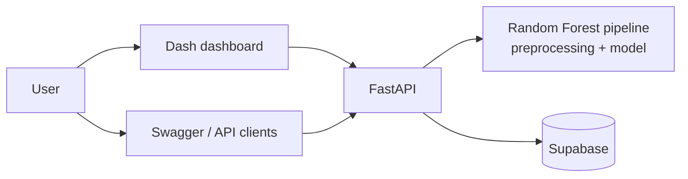

<h1 align="center">🌲 ForestVision — Forest Cover Type Classification API</h1>

<p align="center">
  Multiclass ML model served as a REST API and an interactive dashboard that predicts<br/>
  which of 7 forest cover types grows on a piece of land from its cartographic features.
</p>

<p align="center">
  
  
  
  
  
  
  
</p>

<p align="center">
  🌐 <a href="https://g5-ai-regresion-multiclase.onrender.com/"><b>Live dashboard</b></a> ·
  ⚡ <a href="https://forestvision.onrender.com/docs"><b>Live API (Swagger)</b></a>
</p>

> ⏳ Hosted on Render's free tier: the first request may take ~1 minute while the service wakes up.

---

## 🎯 The problem

Mapping forest cover over large areas with field surveys is slow and expensive. Using the [UCI Covertype dataset](https://archive.ics.uci.edu/dataset/31/covertype) (≈581k samples of 30×30 m cells in Colorado, 54 features: elevation, slope, distances to water/roads/fire points, hillshade, wilderness area and soil type), the model predicts the dominant tree cover type from data that is cheap to obtain.

## ✨ Features

- **End-to-end ML**: EDA → model comparison (from Logistic Regression to Random Forest) → class rebalancing with SMOTE → tuned Random Forest pipeline (200 trees)
- **REST API with FastAPI**: `/predict` for one sample, `/predict/batch` for many, `/info` for model metadata, validated with Pydantic schemas
- **Interactive dashboard** in Plotly Dash with input forms, charts and result tables
- **Every prediction stored** in Supabase (PostgreSQL)
- **Dockerised** and **deployed on Render**
- **Tests** for the API

## 🏗️ Architecture



<p align="center"></p>

## 👤 My role

Team project of 4 at the Factoría F5 AI Bootcamp. **I created the repository and was the main contributor**:

- Project setup, EDA base and data encoding
- **FastAPI** service: model loading, prediction endpoints and schemas
- Model training script and final pipeline
- **Supabase** integration to save every prediction
- **Docker** setup and **deployment on Render**, including working around the model file size limits of the free tier
- API tests

## 🚀 Run it locally

```bash
git clone https://github.com/mr-melenas/forest-cover-api.git
cd forest-cover-api

# Option A — Docker
docker compose up --build

# Option B — manual
pip install -r requirements.txt
uvicorn main:app --reload          # API → http://localhost:8000/docs
python frontend/app_dash.py        # Dashboard
```

Environment variables: `SUPABASE_URL`, `SUPABASE_KEY`.

### Example request

```bash
curl -X POST https://forestvision.onrender.com/predict \
  -H "Content-Type: application/json" \
  -d '{"Elevation": 2596, "Aspect": 51, "Slope": 3, "Horizontal_Distance_To_Hydrology": 258, "...": "..."}'
```

## 👥 Team

Built at [Factoría F5](https://factoriaf5.org/) by [@mr-melenas](https://github.com/mr-melenas) (Max Beltrán), Andreina Suescum, Alejandro Rajado Martín and Orlando Alcalá ([@odar1997](https://github.com/odar1997)).
